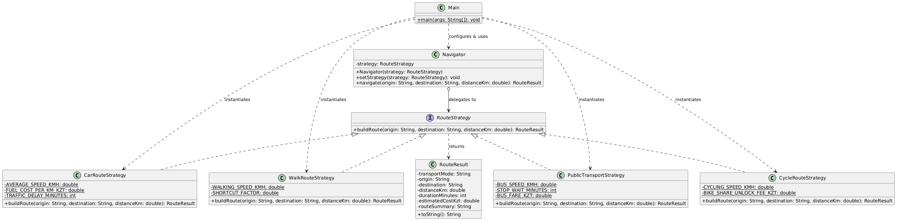
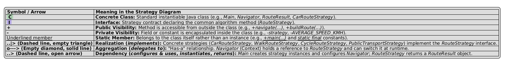

# Assignment 5 — Strategy Pattern Report 
**Student Name:** Askhat Bekeshev  
**Group:** SE-2524
Option A — Navigation / Route Planning

---

## 1. Introduction
In a navigation and route-planning application, users need to calculate routes between an origin and a destination using different modes of transportation: driving a car, walking, cycling, or taking public transit. Although the input parameters (origin, destination, base distance) and output structure (`RouteResult`) remain identical, the underlying calculation algorithm varies significantly across modes (e.g., accounting for fuel costs and traffic delays for cars, pedestrian shortcuts for walking, or fixed fares and stop wait times for buses).

Hardcoding all these calculation formulas inside the `Navigator` class using `if/else` or `switch` statements would violate the Single Responsibility and Open/Closed principles. The **Strategy** pattern solves this by extracting each route calculation algorithm into a separate class implementing a common `RouteStrategy` interface, allowing `Navigator` to switch algorithms dynamically at runtime.

---

## 2. UML Class Diagram

---

## 3. Clean Code Principles Applied

### Principle 1: Elimination of Conditional/Branching Logic in Favor of Polymorphism
**Justification:** Instead of inspecting a transport mode string with `if/else` or `switch` blocks inside `Navigator`, polymorphic method dispatch delegates execution directly to the active `RouteStrategy` object.

**Before (Anti-pattern with branching):**

    public RouteResult navigate(String mode, String origin, String destination, double km) {
        if ("CAR".equals(mode)) {
            return calculateCarRoute(origin, destination, km);
        } else if ("WALK".equals(mode)) {
            return calculateWalkRoute(origin, destination, km);
        } else if ("CYCLE".equals(mode)) {
            return calculateCycleRoute(origin, destination, km);
        }
        throw new IllegalArgumentException("Unknown mode");
    }

**After (Applied in `Navigator.java`):**

    public RouteResult navigate(String origin, String destination, double distanceKm) {
        return strategy.buildRoute(origin, destination, distanceKm);
    }

### Principle 2: Meaningful, Intention-Revealing Names
**Justification:** Interfaces, classes, constants, and methods clearly express domain concepts (`RouteStrategy`, `CarRouteStrategy`, `FUEL_COST_PER_KM_KZT`) rather than vague identifiers like `Strategy1` or `calc()`.

**Before:**

    public class StratA implements IStrat {
        public Object doCalc(String a, String b, double d) { ... }
    }

**After (Applied in `CarRouteStrategy.java`):**

    public class CarRouteStrategy implements RouteStrategy {
        private static final double AVERAGE_SPEED_KMH = 45.0;
        private static final double FUEL_COST_PER_KM_KZT = 35.0;
        private static final int TRAFFIC_DELAY_MINUTES = 8;

        @Override
        public RouteResult buildRoute(String origin, String destination, double distanceKm) { ... }
    }

### Principle 3: Single Responsibility Principle (SRP — Clean Code Ch. 10)
**Justification:** Each concrete strategy class has one and only one reason to change: a modification to its specific transportation formula. `CarRouteStrategy` handles only driving math, while `WalkRouteStrategy` handles only pedestrian shortcuts.

**Applied in `WalkRouteStrategy.java`:**

    public class WalkRouteStrategy implements RouteStrategy {
        private static final double WALKING_SPEED_KMH = 5.0;
        private static final double SHORTCUT_FACTOR = 0.85;

        @Override
        public RouteResult buildRoute(String origin, String destination, double distanceKm) {
            validateInput(origin, destination, distanceKm);
            double effectiveDistance = distanceKm * SHORTCUT_FACTOR;
            int travelMinutes = (int) Math.round((effectiveDistance / WALKING_SPEED_KMH) * 60);
            String summary = "Through pedestrian zones, parks, and courtyard shortcuts";
            return new RouteResult("Walking", origin, destination, effectiveDistance, travelMinutes, 0.0, summary);
        }
    }

### Principle 4: Context Remains Algorithm-Agnostic
**Justification:** `Navigator` holds only a private reference to the `RouteStrategy` interface and has zero knowledge of speed constants, fuel rates, or shortcut multipliers inside concrete strategies.

**Applied in `Navigator.java`:**

    public class Navigator {
        private RouteStrategy strategy;

        public void setStrategy(RouteStrategy strategy) {
            if (strategy == null) {
                throw new IllegalArgumentException("Route strategy cannot be null.");
            }
            this.strategy = strategy;
        }
    }

### Principle 5: Easy Extensibility (Open/Closed Principle — Clean Code Ch. 10)
**Justification:** The system is open for extension but closed for modification. We added a fourth strategy (`PublicTransportStrategy`) and plugged it into `Navigator` at runtime without touching `Navigator` or any of the existing three strategies.

**Applied in `PublicTransportStrategy.java` and `Main.java`:**

    navigator.setStrategy(new PublicTransportStrategy());
    System.out.println(navigator.navigate(origin, destination, distanceKm));

---

## 4. Strategy vs. State Pattern
Although **Strategy** and **State** share an almost identical UML structure (both use composition and delegation to polymorphic implementations behind an interface), their **intent** is fundamentally different. The **State** pattern is used when an object's behavior changes automatically based on its internal lifecycle transitions (e.g., an `Order` transitioning from `Pending` to `Paid` to `Shipped`), and the states themselves are often aware of each other to trigger transitions. In contrast, our navigation problem requires the **Strategy** pattern because `CarRouteStrategy`, `WalkRouteStrategy`, and `CycleRouteStrategy` are independent, interchangeable algorithms for the same task ("how to calculate a route"). They do not represent lifecycle stages of a navigator, they are completely unaware of each other, and the **Client** explicitly selects and swaps the desired algorithm at runtime based on user preference.

---

## 5. Conclusion
Applying the Strategy pattern significantly improved the flexibility and maintainability of the route planner. We eliminated brittle conditional chains in `Navigator`, isolated each transport mode's math and constants into small, cohesive classes, and gained the ability to swap algorithms at runtime or introduce new transport modes (`PublicTransportStrategy`) without risking regressions in existing code. The main trade-off is the increased number of classes (creating a separate class per algorithm) and the requirement that the client must understand the differences between strategies in order to choose the right one.

---

## 6. GitHub Repository Link
**Repository URL:** https://github.com/SolomonDemeter07/SDP_Assignment5_Strategy

---

## References
1. Freeman, E., & Robson, E. (2021). *Head First Design Patterns* (2nd ed.), Chapter 1 (Strategy).
2. Martin, R. C. (2008). *Clean Code: A Handbook of Agile Software Craftsmanship*, Chapter 10 (Classes).
3. Astana IT University, *Lecture 7 Slides: Strategy Pattern and Comparison with State Pattern*.
4. Refactoring.Guru — *Strategy Design Pattern*: https://refactoring.guru/design-patterns/strategy